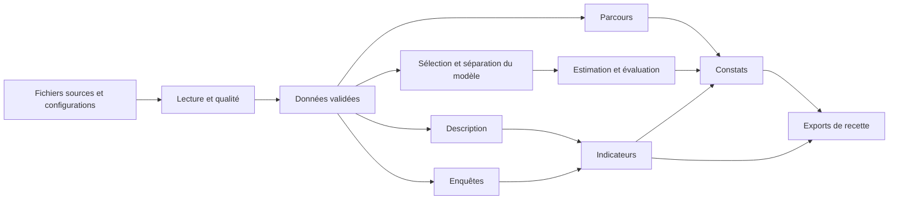

# Étape 26 — Cadrage de l'automatisation et des interfaces

Date : 19 octobre 2026. Statut : cadrage validé ; premier pipeline aval mis en
œuvre à l'étape 27, voir `docs/pipeline_targets.md`. Démonstrateur personnel indépendant de l'UPEC, données
exclusivement synthétiques. Cette étape n'installe rien, ne lance aucun pipeline
et ne modifie pas les données ou les paramètres de VS Code.

## Audit réellement réalisé

L'audit R se reproduit depuis la racine avec :

```powershell
& 'C:\Program Files\R\R-4.6.1\bin\Rscript.exe' --no-save --no-restore scripts/audit_automation.R
```

Ce chemin absolu décrit l'exécutable observé sur le poste ; les fonctions métier
continueront à employer des chemins relatifs avec `here` et `fs`. `Rscript` n'est
pas dans le PATH de la session examinée. Les tâches VS Code utilisent déjà
l'exécutable configuré ; aucun ajout au PATH n'est nécessaire pour ce cadrage.

| Composant | État vérifié | Conséquence |
|---|---|---|
| R du projet | 4.6.1 ; `renv::status()` cohérent | Base actuelle conservée |
| `targets` | 1.12.0 ; API principale exportée | Premier pipeline possible sans installation |
| `_targets.R` et `_targets/` | Absents | Aucun pipeline existant à préserver ou relancer |
| Quarto CLI / package R `quarto` | 1.10.18 / 1.5.1 | Outils distincts disponibles ; rendu déjà utilisé |
| `tarchetypes` | Indisponible dans le projet | Facultatif ; non nécessaire au premier pipeline de calcul |
| `shiny` / `DT` | Indisponibles dans le projet | Installation ciblée à prévoir lors de l'étape applicative |
| `bslib` | 0.12.0, disponible dans le projet | À déclarer comme dépendance directe de l'application si retenue |
| `yaml` | 2.3.12, disponible et déclaré | Catalogue d'indicateurs réutilisable |
| `dashboard/` | Seulement le fichier de conservation du dossier | Aucune application Shiny existante |
| `_quarto.yml` | Absent | Rendus autonomes actuels, pas de projet Quarto global |
| Power BI Desktop | Registre : version 2.146.1454.0 ; exécutable localisé | Présence confirmée ; ouverture et actualisation non testées |

Les contrôles Windows sont conservés dans
`outputs/cadrage_automatisation/prerequis_windows.csv`. L'exécutable Power BI
a été retrouvé dans son dossier standard après la vérification du registre.
Aucun compte Power BI Service, espace de travail, licence, passerelle ou
planification n'a été inspecté : aucun usage de ces services n'est présumé.

L'audit R produit inventaire des packages, points d'entrée, API, empreintes
des données et archive de session dans `outputs/cadrage_automatisation/`.
Il ne lance pas `tar_make()` et ne crée pas `_targets.R`.

## Points à résoudre avant une automatisation complète

1. **Un seul producteur par fichier.** Les notebooks exécutent aujourd'hui des
   calculs et écrivent leurs propres CSV/RDS. Le pipeline devra produire les
   objets et les exports ; les rapports devront ensuite les consommer. Deux
   branches ne doivent pas modifier le même fichier.
2. **Sauvegardes protégées.** `save_raw_dataset()` et `save_processed_tables()`
   refusent un objet divergent. C'est une protection à conserver. Un cache
   `targets` ne constitue pas une autorisation d'écraser les sources.
3. **Données et audit distincts.** Un changement de code, de lockfile ou de
   documentation peut faire évoluer un audit même lorsque les nombres sont
   identiques. Ne pas contourner le refus de sauvegarde en supprimant le fichier.
4. **Dépendances explicites.** Configurations, fichiers d'entrée, lockfile,
   fonctions, documents utilisés et fichiers produits devront être suivis.
   Un appel qui lit un chemin caché dans son corps ne suffit pas à prouver
   que ce fichier est correctement déclaré dans le graphe.
5. **Pas de cycle de provenance.** Un rapport ou une restitution ne devra pas
   dépendre d'une archive qu'il réécrit lui-même. Les empreintes des sources
   seront distinctes des empreintes des produits.
6. **Pas d'horodatage comme graine.** Conserver le gel et les graines validés.
   Une date d'exécution appartient au journal, pas aux paramètres du calcul.

## Premier lot proposé : pipeline de calcul sur les tables préparées

Le premier `_targets.R` partira des tables existantes contrôlées dans
`data/processed/`. Cette entrée est volontairement limitée : elle permet de
valider l'orchestration sans modifier les sauvegardes canoniques ni réécrire
les audits historiques. Elle ne sera pas annoncée comme une reconstruction
complète depuis les graines.

Les nouvelles sorties de recette seront isolées dans `outputs/pipeline/`.
Les rapports déjà produits resteront lisibles et inchangés. Une comparaison
numérique permettra de vérifier que le pipeline reproduit les résultats des
étapes 18 à 25 avant d'en faire une nouvelle source de référence.

Graphe technique proposé (distinct d'un graphe causal) :



| Groupe de cibles proposé | Entrées explicites | Résultat et règle |
|---|---|---|
| Précontrôles | `renv.lock`, DESCRIPTION, fichiers de configuration | Échec explicite si dépendances ou gel incompatibles |
| Fichiers sources | RDS et manifeste de `data/processed/` | Fichiers suivis, présence et intégrité vérifiées |
| Données contrôlées | Tables normalisées, métadonnées | Qualité conforme, puis rapprochement de la table analytique avec sa reconstruction |
| Description | Données validées | Volumes, caractéristiques et validation |
| Enquêtes | Données validées | Invitations, réponses, satisfaction, devenir et éligibilité |
| Parcours | Données validées, années fixes | Cohortes, matrices, sorties et censures |
| Population et séparation du modèle | Coupe initiale, références, graine 20261020 | Sélection explicite, apprentissage/test disjoints |
| Modèle et diagnostics | Apprentissage | GLM validé, IC, diagnostics ; aucune utilisation du test pour choisir la formule |
| Évaluation | Modèle, test, fréquence apprise sur apprentissage | Scores, calibration et référence constante |
| Indicateurs | Agrégats et catalogue YAML | Dix séries, mêmes dénominateurs, seuils et statuts |
| Faisabilité causale | Inventaire et décisions méthodologiques | Aucun effet causal estimé |
| Constats | Résultats numériques courants | Construction en mémoire, sans relecture circulaire d'anciens exports |
| Exports de recette | Objets précédents | Un producteur par artefact, chemins retournés comme fichiers suivis |

La qualité doit être une dépendance effective de toutes les analyses, pas une
branche indépendante que le pipeline pourrait ignorer. Les objets nécessaires
aux constats seront assemblés directement à partir des cibles ; le lecteur
actuel des archives restera utile au fonctionnement manuel des notebooks.

Les principes de cibles, graphe de dépendances et fichiers suivis s'appuient sur
[le manuel officiel de targets](https://books.ropensci.org/targets/targets.html).
Le choix de commencer sur les tables préparées relève du présent projet.

## Recette du premier pipeline

Les commandes ci-dessous décrivent l'API de diagnostic. Le point d'entrée
avec journalisation de l'étape 27 est `scripts/run_pipeline.R` ; la recette
complète est dans `scripts/check_pipeline.R`.

```r
targets::tar_validate()
targets::tar_manifest()
targets::tar_make()
targets::tar_outdated()
targets::tar_meta(fields = c(name, error, warnings, seconds))
```

Critères de validation :

- Graphe sans cycle, sources et dépendances attendues visibles.
- Première exécution complète avec qualité et checks de séparation actifs.
- Résultats numériques concordants avec les références actuelles : effectifs,
  états de transition, décisions, indicateurs et performances, sans exiger une
  identité binaire des fichiers de session ou des journaux.
- Deuxième exécution inchangée sans recalcul inutile ; examen des cibles périmées.
- Suppression d'un export de recette : reconstruction du fichier nécessaire.
- Changement contrôlé de configuration dans un scénario isolé : seules les
  branches dépendantes sont invalidées ; les sources canoniques restent intactes.
- Anomalie dans une copie de données : arrêt avant analyses et exports ; échec
  journalisé, pas de réussite annoncée et pas de produit incomplet utilisé.
- Reprise après échec sans purge arbitraire du cache ou des sources.

Le journal d'exécution devra distinguer succès et échec. Les sorties d'un ancien
succès ne devront pas être présentées comme les résultats d'une exécution échouée.
Aucune suppression de `_targets/` ne sera une procédure normale de relance.

## Lots suivants

### Reconstruction depuis les graines et intégration des rapports

Mise à jour étape 28 : le mode isolé de reconstruction depuis les graines est
implémenté. Voir `docs/pipeline_targets.md` et `scripts/check_reconstruction.R`.
Les paragraphes suivants conservent les principes du cadrage ; l'intégration
des rapports et toute promotion des données restent à réaliser.

Mise à jour étape 29 : un rapport détaillé et une note Quarto consommateurs
sont intégrés au mode optionnel documenté dans `docs/pipeline_targets.md`.
Les notebooks pédagogiques conservent leur fonctionnement manuel ; aucune
promotion des sauvegardes canoniques n'est réalisée.

Après recette du premier lot, étendre le graphe à la génération, aux anomalies
contrôlées et au nettoyage. Tester la reconstruction dans un espace de scénario
isolé, avec les mêmes fonctions de protection, avant de discuter la promotion
de nouvelles données comme référence. La reproduction totale depuis les graines
restera un critère de livraison, distinct du premier pipeline aval.

Extraire les écritures actuellement dans les notebooks vers des fonctions
d'export réutilisables. Adapter ensuite les rapports pour qu'ils lisent les
produits du graphe, en conservant un chemin de reproduction manuelle documenté.
Le rendu Quarto suivra les sources `.qmd`, leurs dépendances éditoriales et les
exports ; il ne devra pas recalculer une autre version cachée de l'analyse.
`tarchetypes` pourra être justifié si ses fonctions de rendu apportent un
bénéfice réel, mais ne sera pas installé par défaut
([documentation des rapports dans targets](https://books.ropensci.org/targets/literate-programming.html)).

### Application Shiny

Mise à jour étape 30 : l'application locale, les exports en étoile et le projet
Power BI sont construits. Le guide `docs/tableaux_de_bord.md` détaille leurs
commandes, le contrôle des actualisations et la portée exacte de la recette.

Installer seulement les dépendances nécessaires à cette étape, notamment
`shiny` et `DT`, puis déclarer `bslib` comme dépendance directe si utilisé.
Développer dans `dashboard/` à partir d'exports validés : aucune estimation
ou réécriture de données déclenchée par un filtre utilisateur.

Prévoir pages inscriptions, réussite, parcours, enquêtes et insertion ; afficher
population, date de référence, couverture, dénominateur et raison d'absence.
Recetter les filtres simples et combinés, les sélections vides, les petits
effectifs, la censure et les millésimes du devenir. Aucun déploiement n'est
inclus dans le premier lot de pipeline.

### Power BI et automatisation

Auditer l'ouverture locale de Power BI Desktop, puis fixer un format source
éditable adapté aux possibilités réelles. Définir le schéma des dimensions et
des faits avant les pages : formations, niveaux, années, vagues et diplômes de
référence selon leur granularité.

Produire un contrat d'export R dans `outputs/powerbi/` avec clés stables,
encodage UTF-8, types, dates ISO, valeurs manquantes et statut. Le tableau des
33 indicateurs de l'étape 24 n'offre pas à lui seul toutes les dimensions d'un
modèle filtrable : créer les granularités nécessaires et vérifier les mesures.
Les taux reposent sur des effectifs compatibles, pas une moyenne de pourcentages.
Les distincts pluriannuels demandent une méthode adaptée, sans sommer les années.

Recetter les cinq pages prévues, les filtres, les mesures et l'actualisation à
partir des nouveaux fichiers. Distinguer : génération R des exports, actualisation
locale du rapport, éventuelle actualisation dans Power BI Service. Une présence
de Desktop ne prouve ni la disponibilité d'un service ni sa planification.
Aucune publication, connexion de compte ou planification Windows n'est engagée.

## Statut de sortie de l'étape

Audit de préparation exécuté ; données et paramètres préservés. Le plan est
concret et les dépendances sont identifiées. Aucun `_targets.R`, pipeline,
application Shiny ou rapport Power BI n'est créé à cette étape. La prochaine
action proposée est l'implémentation et la recette du premier pipeline aval.
